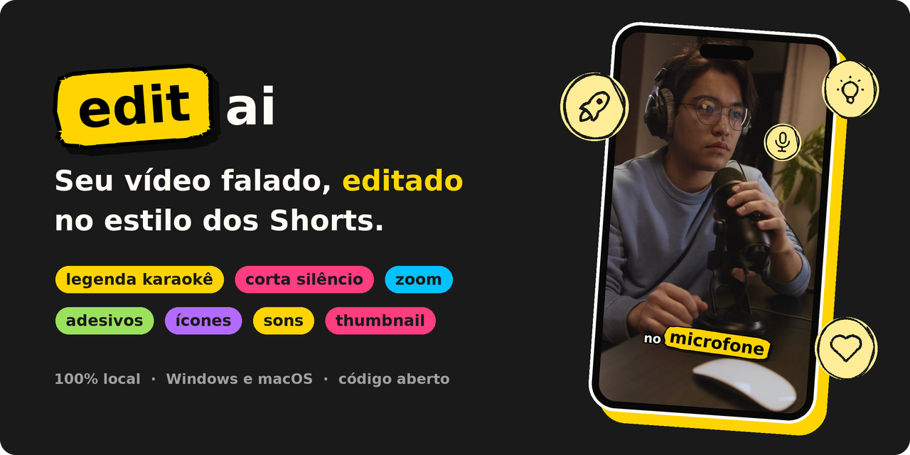

<p align="center">
  
</p>

<p align="center">
  <b>Arraste um vídeo em que você fala. Receba ele cortado, legendado e cheio de ênfase,<br>
  sem mandar nada para a internet.</b>
</p>

<p align="center">
  <a href="https://github.com/lucasteles1231/editai/actions/workflows/testes.yml"></a>
  <a href="https://github.com/lucasteles1231/editai/releases/latest"></a>
  
  
  <a href="LICENSE"></a>
</p>

<p align="center">
  <a href="https://lucasteles1231.github.io/editai/baixar"><b>Baixar</b></a> ·
  <a href="https://lucasteles1231.github.io/editai/">Site e documentação</a> ·
  <a href="https://lucasteles1231.github.io/editai/guia/comeco-rapido">Começo rápido</a> ·
  <a href="https://lucasteles1231.github.io/editai/guia/o-que-ele-faz">O que ele faz</a> ·
  <a href="https://lucasteles1231.github.io/editai/versoes">Versões</a>
</p>

---

Você grava falando, com as pausas e os respiros de quem fala. O **Editai** faz
a edição que tomaria uma tarde, no estilo dos Shorts, Reels e TikTok:

- corta os silêncios;
- escreve a legenda palavra por palavra;
- faz as palavras importantes saltarem da tela;
- põe zoom, ícones e efeitos sonoros;
- e ainda gera a thumbnail.

Para um vídeo de notícia, você nem aparece: traz uma pasta de cenas (ou um vídeo longo, que
ele separa em cenas), a narração (ou só o roteiro, lido pela sua voz, gravada uma vez) e, se
quiser, um personagem ou o seu avatar. Ou só o tema: a IA escreve o roteiro, o Editai acha
fotos com licença livre e uma voz narra.

Por padrão, ele roda **inteiro no seu computador**, sem conta, sem chave de API, sem
assinatura e sem marca d'água. A transcrição é feita pelo Whisper na sua própria máquina,
e o vídeo não vai para servidor nenhum.

<p align="center">
  
</p>

> [!TIP]
> Este README é o resumo. A documentação completa, com cada função em detalhe, está no
> **[site do Editai](https://lucasteles1231.github.io/editai/)**.

## Instalar

No **macOS** ou no **Linux**, cole no Terminal:

```bash
curl -LsSf https://lucasteles1231.github.io/editai/instalar.sh | sh
```

No **Windows**, cole no PowerShell:

```powershell
powershell -ExecutionPolicy ByPass -c "irm https://lucasteles1231.github.io/editai/instalar.ps1 | iex"
```

O instalador põe o [uv](https://docs.astral.sh/uv/) (que cuida do Python sem mexer no do
sistema), instala o Editai e cria o atalho **Editai**. Prefere um arquivo para abrir com
dois cliques? Ele está na [página de download](https://lucasteles1231.github.io/editai/baixar).
O que o instalador faz, passo a passo, e como instalar à mão estão em
[Instalação em detalhe](https://lucasteles1231.github.io/editai/guia/instalacao-em-detalhe).

## O que ele faz

| Função | O que é |
|---|---|
| **[Corta os silêncios](https://lucasteles1231.github.io/editai/guia/o-que-ele-faz)** | toda pausa vira um respiro curto, com o corte medido no áudio |
| **[Legenda karaokê](https://lucasteles1231.github.io/editai/guia/o-que-ele-faz)** | a palavra acende quando é dita; também em `.srt` e `.vtt` |
| **[Adesivos, zoom e ícones](https://lucasteles1231.github.io/editai/guia/o-que-ele-faz)** | números e palavras fortes saltam da legenda; falou "dinheiro", aparece a moeda |
| **[Efeitos sonoros](https://lucasteles1231.github.io/editai/guia/efeitos-sonoros)** | sete temas, e a palavra chama o som dela |
| **[A montagem em camadas](https://lucasteles1231.github.io/editai/guia/a-montagem-em-camadas)** | um fundo ou uma [biblioteca de cenas](https://lucasteles1231.github.io/editai/guia/a-montagem-em-camadas#biblioteca-de-cenas), e você, um personagem ou o seu avatar por cima |
| **[Cartões animados](https://lucasteles1231.github.io/editai/guia/cartoes-animados)** e **[legenda em destaques](https://lucasteles1231.github.io/editai/guia/a-legenda-em-destaques)** | selo, lista, quadro e número na palavra certa; opcionais, com o Gemini |
| **[Voz e bipe](https://lucasteles1231.github.io/editai/guia/voz-e-bipe)** e **[efeitos na voz](https://lucasteles1231.github.io/editai/guia/efeitos-na-voz)** | voz limpa ou de estúdio, robô ou esquilo, e bipe nas palavras proibidas |
| **[O vídeo só pelo tema](https://lucasteles1231.github.io/editai/guia/o-video-so-pelo-tema)** | escreva o assunto: a IA escreve o roteiro, você revisa, as fotos chegam com os créditos e uma voz narra |
| **[Minha voz](https://lucasteles1231.github.io/editai/guia/minha-voz)** | leia um texto uma vez, e a sua voz narra qualquer roteiro |
| **[Meu avatar](https://lucasteles1231.github.io/editai/guia/meu-avatar)** | um personagem seu em pixel art, de pessoa ou de bicho, que fala no seu lugar |
| **[Presets](https://lucasteles1231.github.io/editai/guia/presets)** | gameplay, vlog, review, aula, notícia: um clique muda tudo |
| **[A thumbnail](https://lucasteles1231.github.io/editai/guia/a-thumbnail)** | a pessoa recortada na frente de outro quadro, no formato de cada plataforma |

## Como usar

1. **Abra** pelo atalho **Editai**, ou com `editai` num terminal. O navegador abre sozinho.
2. **Marque o que você tem** no passo 1 (o vídeo, o roteiro, as cenas…) e mande os arquivos.
3. **Clique em Editar vídeo.** O resultado sai pronto para baixar, com a thumbnail.

O passo a passo, com cada opção, está em [Como usar](https://lucasteles1231.github.io/editai/guia/como-usar).
Tudo também funciona [no terminal](https://lucasteles1231.github.io/editai/guia/no-terminal):
`editai meu-video.mp4`.

## O que ele pede do computador

- **O mínimo:** uns 0,8 GB de disco (o editor e o modelo de transcrição) e 8 GB de memória.
- **A Minha voz,** opcional: mais uns 3,5 GB e, de preferência, um Mac com chip Apple ou um
  PC com placa NVIDIA.
- **A voz local,** opcional: mais uns 210 MB, em qualquer computador.
- **Internet:** só para instalar e no primeiro uso de cada modelo.

O detalhe de cada função, medido, está em
[O que cada função precisa](https://lucasteles1231.github.io/editai/guia/o-que-cada-funcao-precisa).

## Versões, atualizar e desinstalar

- **As versões** e o que mudou em cada uma estão no [CHANGELOG.md](CHANGELOG.md) e no
  [site](https://lucasteles1231.github.io/editai/versoes).
- **Atualizar:** o Editai avisa quando sai uma versão nova (uma vez por dia, e dá para
  desligar). Feche o Editai e rode `editai --atualizar`, ou o instalador de novo. Veja
  [Atualizar](https://lucasteles1231.github.io/editai/guia/instalacao-em-detalhe#atualizar).
- **Desinstalar:** `editai --desinstalar` mostra tudo o que o Editai guardou e só apaga
  depois de você digitar "sim". Veja
  [Desinstalar](https://lucasteles1231.github.io/editai/guia/instalacao-em-detalhe#desinstalar).

## Segurança e privacidade

Nada do vídeo, do áudio nem da sua voz sai do computador. O que sai, e só quando você usa:

- o texto da fala e quadros pequenos para o Gemini, com a sua chave;
- no vídeo só pelo tema, o tema e o roteiro para o Gemini, com a sua chave;
- a busca de fotos no Pexels e no Openverse;
- os downloads da instalação e dos modelos;
- o pedido da última versão ao GitHub, uma vez por dia.

A página só aceita o seu computador, e cada sessão tem um token. A lista completa, e como
a página é protegida, está em
[Segurança e privacidade](https://lucasteles1231.github.io/editai/guia/seguranca-e-privacidade).
Para relatar uma falha, veja o [SECURITY.md](SECURITY.md).

## Desenvolvimento

```bash
git clone https://github.com/lucasteles1231/editai
cd editai
uv sync
uv run pytest -m "not navegador"
```

A página fica em `web/`, o site em `docs/` e os instaladores em `instalador/`. Como rodar
cada um, os testes e como publicar uma versão estão em
[Desenvolvimento](https://lucasteles1231.github.io/editai/guia/desenvolvimento).

## Créditos e licenças

- **Henrique Monteiro**, co-participante: os testes práticos e as ideias.
- **Guilherme Cabrera**, mentor: as dúvidas e as ideias de ajustes.

O código é **MIT** ([LICENSE](LICENSE)). Fontes, ícones, sons, modelos e bibliotecas de
terceiros, cada um com a sua licença, estão em [TERCEIROS.md](TERCEIROS.md) e em
[Créditos e licenças](https://lucasteles1231.github.io/editai/guia/creditos-e-licencas).
**Atenção ao Remotion**, usado na prévia da thumbnail: ele **não é MIT**, e empresas com
mais de 3 funcionários precisam de uma [licença da Remotion](https://www.remotion.pro/license).
