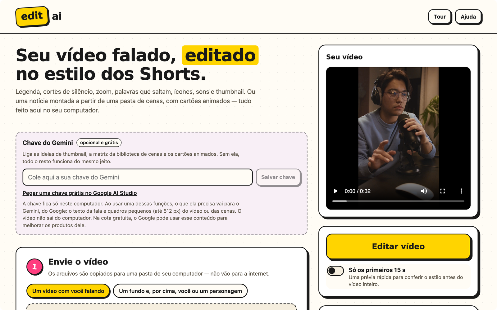
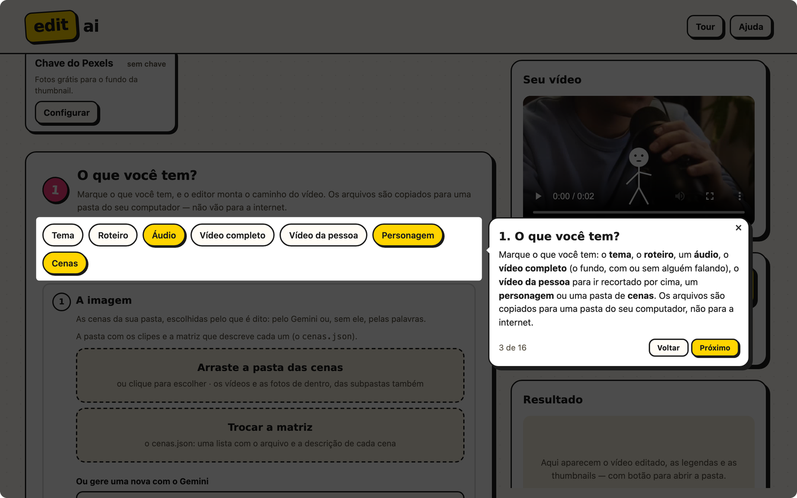
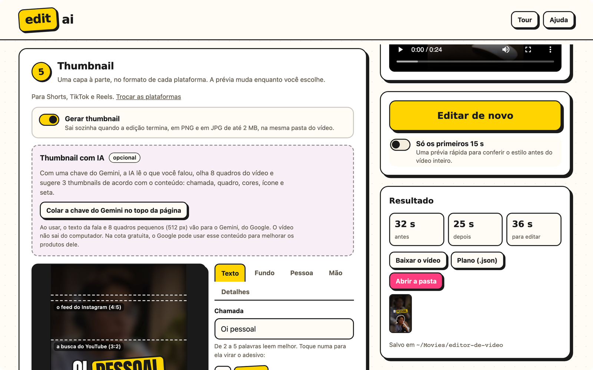
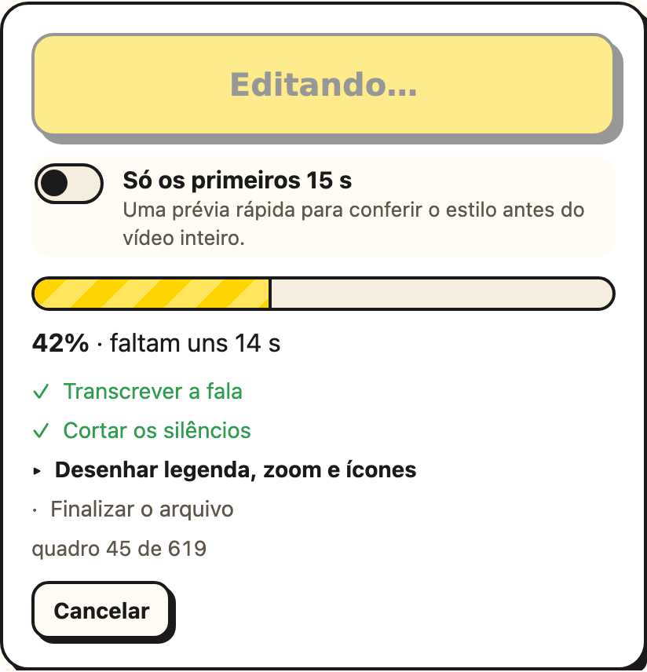

# A interface

Digite `editai` e o navegador abre no editor. O caminho é sempre o mesmo: enviar o vídeo,
escolher as edições, escolher a saída e, se quiser, a thumbnail.

<picture>
  <source media="(prefers-color-scheme: dark)" srcset="../img/interface-escuro.png">
  
</picture>

<table>
  <tr>
    <td width="50%"></td>
    <td width="50%"></td>
  </tr>
  <tr>
    <td><b>Tour guiado.</b> Na primeira visita, dezesseis balões curtos mostram como começar
    pelo que você tem e cada parte da página, de "Antes de começar" ao resultado. O botão
    <b>Tour</b> refaz quando quiser.</td>
    <td><b>Thumbnail e resultado.</b> A prévia muda enquanto você escolhe. Toque numa palavra
    do título para ela virar o adesivo.</td>
  </tr>
</table>

- **Antes de começar:** os cartões do que é opcional e se configura uma vez: a sua voz
  (gravar, ouvir e apagar), o seu [avatar](./meu-avatar) e as chaves do Gemini e do Pexels.
- **Envio:** um vídeo só, ou a montagem em camadas: o fundo (um vídeo ou a biblioteca de
  cenas), a pessoa, o personagem ou nada por cima, e a escolha de onde vem o áudio (o
  fundo, a pessoa ou arquivos separados). Embaixo, onde você vai postar: o editor
  recomenda pelo formato do vídeo.
- **Edições:** comece por um preset e ajuste o que quiser: cada efeito, a janela com
  câmera, os cartões animados, a voz, o bipe, o ritmo, a pausa, o zoom e os sons, com um
  botão para ouvir cada tema. Do jeito que ficar, **Salvar como preset** guarda um seu.
- **Legenda:** o idioma da fala, o tamanho do modelo, o estilo (clássico ou destaques), o
  tamanho da letra, quantas letras cabem numa linha e se quer o `.srt` e o `.vtt`.
- **Saída:** a extensão (MP4, MOV, WebM, MKV ou GIF), o codec, a resolução, os quadros por
  segundo e a qualidade. Só aparece o que o seu computador consegue gravar.
- **Só os primeiros 15 s:** uma prévia rápida para conferir o estilo antes de editar o vídeo
  inteiro.
- **Progresso:** cada etapa, com o tempo que falta, e um botão de cancelar.
- **Resultado:** assista, baixe o vídeo, as legendas e as thumbnails, ou abra a pasta onde
  tudo foi salvo. Com o roteiro do Gemini, ele diz quantas cenas e cartões vieram e
  quantos pedidos da cota foram usados; sem ele, por quê.

Funciona no Chrome, no Edge, no Firefox e no Safari, no tema claro ou escuro, o mesmo do
seu sistema.

 
