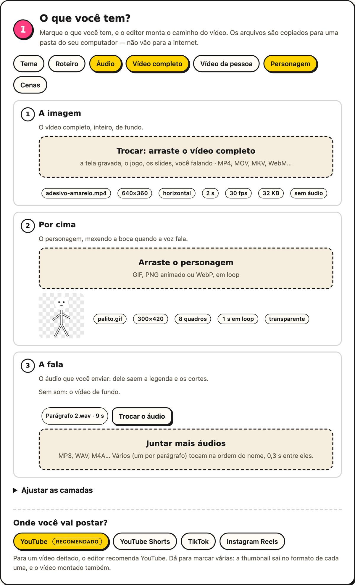
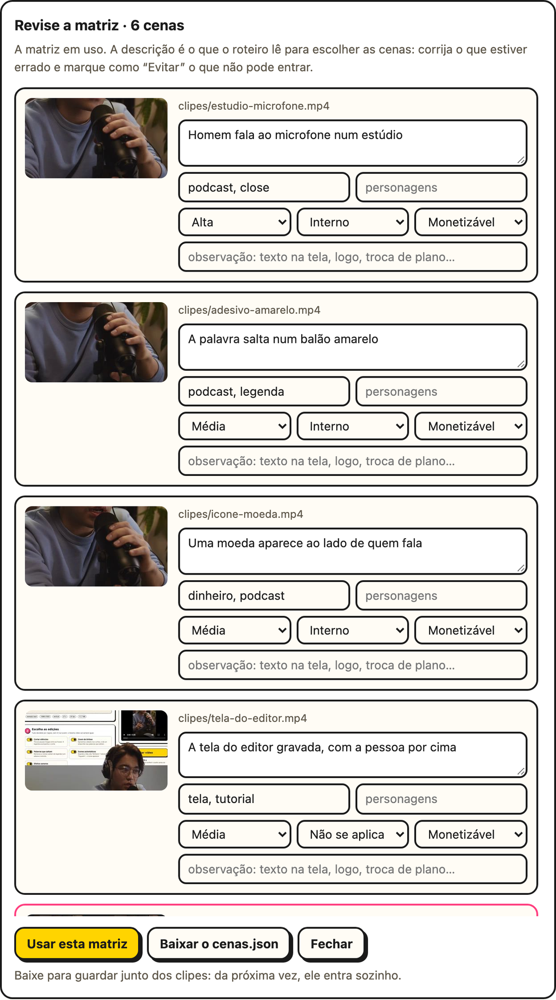

# A montagem em camadas

Quando o assunto está na tela (um tutorial, um jogo, slides), grave o fundo e a sua fala
separados. No passo 1, marque **Vídeo completo** (o fundo) e o que vai por cima, **Vídeo da
pessoa** ou **Personagem**, e o **Áudio**, se a fala veio à parte:

<p align="center">
  
</p>

- **O fundo:** um vídeo sem pessoa, que começa junto com a fala e, se for mais curto,
  volta ao começo; ou a [biblioteca de cenas](#biblioteca-de-cenas).
- **Por cima, o vídeo da pessoa:**
  - se ele já vem sem fundo (WebM VP9 ou MOV com transparência), vale o recorte do
    próprio arquivo, sem custo nenhum;
  - senão, o MODNet recorta o vídeo inteiro no seu computador, e a página mostra quanto
    tempo isso leva.
- **Ou por cima, o seu avatar:** o personagem em pixel art feito no cartão
  [Avatar](./meu-avatar), com a pose de cada frase e a boca nas sílabas da voz.
- **Ou por cima, um personagem animado:** um GIF, PNG animado ou WebP de até 64 MB, em
  loop do começo ao fim. Se ele tem um fundo de cor única, essa cor sai.
- **Ou nada por cima:** só o fundo, com a legenda e as animações.
- **A fala** vem do áudio separado (MP3, WAV ou M4A), se você marcou **Áudio**; senão, do
  vídeo de quem fala. Em **Ajustar as camadas**, dá para trocar à mão entre o vídeo de
  fundo, o vídeo da pessoa e o áudio separado. Com o personagem, que não tem som, as
  opções são o fundo e o áudio separado; com a biblioteca de cenas, a pessoa e o áudio
  separado. É desse áudio que saem a legenda e os cortes, e um vídeo sem som fica com a
  opção desligada.
- **Vários áudios** (um por parágrafo, por exemplo) tocam na ordem do nome ("Parte 2"
  antes de "Parte 10"), com as pontas aparadas e 0,3 s entre eles. Cada um é transcrito
  à parte, e a transcrição fica guardada por arquivo.
- **O formato do quadro** segue a plataforma escolhida no passo 1, e dá para trocar no
  passo 4: igual ao fundo, em pé, deitado ou quadrado. O fundo entra inteiro, e as sobras
  ficam com ele mesmo, desfocado.

A pessoa (ou o personagem) começa embaixo no meio, em pé, ou embaixo à direita, deitado e
quadrado. Em alguns cortes, ela anda: com um ícone, para o lado oposto ao dele; com uma
palavra saltando, para perto. **Mover a pessoa**, no passo 2, desliga isso.

## Biblioteca de cenas

Para um vídeo narrado sobre um assunto com muitas imagens (um trailer, uma notícia, um
jogo, o tour por um imóvel), o fundo pode ser uma biblioteca: uma pasta de clipes curtos e
de fotos, e uma matriz que descreve cada um. No passo 1, marque **Cenas** e arraste a
pasta (as subpastas também valem). A matriz que
estiver dentro dela, o `cenas.json`, entra junto; se não estiver, a página pede em
seguida.

- **Vídeos e fotos:** MP4, MOV, WebM e MKV, e JPG, PNG e WebP. Uma foto vale por uma cena
  de 3 s e ganha um movimento lento (aproxima ou afasta um pouco, andando de lado), para
  não ficar parada. A orientação que o celular gravou na foto é respeitada.
- **Em pé ou deitado:** se a maior parte das cenas é em pé, o vídeo sai em pé (a
  plataforma escolhida no passo 1 ainda manda). Cada cena entra no formato do vídeo; a
  muito diferente (uma foto em pé num vídeo deitado) entra inteira, sobre ela mesma
  desfocada, em vez de perder metade no corte.
- **O áudio pode vir das cenas:** com só **Cenas** marcado (ou **Das cenas**, em
  **Ajustar as camadas**), a etapa da fala mostra os vídeos da biblioteca que têm som. Clique neles na ordem em que o som deve tocar: cada um ganha um
  número, e clicar de novo tira. O som deles vira a narração, e as cenas continuam
  escolhidas pelo que é dito: elas não aparecem nessa ordem, nem inteiras. Quando o
  roteiro escolhe um desses vídeos, ele entra no ponto da fala, e a boca de quem fala bate
  com a voz. No terminal, é só passar os vídeos no `--audio`.

A matriz é uma lista em JSON, ou `{"cenas": [...]}`:

```json
[
  {
    "arquivo": "clipes/t1-014-explosao.mp4",
    "descricao": "Carro explode numa rodovia à noite",
    "categorias": ["acao", "carro"],
    "personagens": ["Jason"],
    "energia": "alta",
    "monetizacao": "ok",
    "obs": "logo do jogo no canto de cima"
  }
]
```

| Campo | O que é |
|---|---|
| `arquivo` | o clipe ou a foto, casado pelo nome do arquivo (a pasta não importa). Obrigatório |
| `descricao` | o que aparece nele. Obrigatório |
| `id` | um nome curto; sem ele, vale o nome do arquivo |
| `categorias`, `personagens` | listas, ou texto com vírgulas, que ajudam a escolher |
| `energia` | `baixa`, `media` ou `alta`: o começo do vídeo pede cena forte |
| `monetizacao` | `ok`, `cuidado` (no máximo duas no vídeo) ou `evitar` (nunca entra) |
| `obs` | um aviso para quem escolhe, como uma data antiga num logo |

A página mostra a ficha: quantas cenas entraram (e quantas são fotos), quantas ficaram de
fora por "evitar", quais clipes não têm descrição e quais descrições não têm clipe.

### Gerar a matriz

Você já cortou os clipes e não tem o `cenas.json`? Depois de arrastar a pasta, clique em
**Gerar a matriz**. O campo ao lado, opcional, diz do que são as cenas ("trailers do GTA
6"): com ele, o Gemini reconhece os personagens.



- **O Gemini vê** 3 quadros de cada clipe (começo, meio e fim) e a foto inteira, 12 cenas
  por pedido, e
  escreve a descrição, as categorias, os personagens que ele reconhece, o período, a
  energia (o clima da cena, e não o movimento da câmera), a monetização e o que atrapalha
  usar a cena de fundo (texto na tela, logo, troca de plano no meio).
- **O custo:** 128 clipes são uns 11 pedidos da cota grátis. Cada pedido levou perto de
  50 s no teste, então a biblioteca inteira deve levar uns 10 minutos. As 23 cenas de um
  imóvel (19 fotos e 4 vídeos) levaram 36 s. O que já foi
  descrito fica guardado: gerar de novo, ou depois que a cota acabou, só pede o que
  falta.
- **A cena que o Gemini se recusa a descrever** (nudez, por exemplo) fica marcada como
  "evitar", com um aviso, e o resto do lote segue.
- **Sem a chave**, sai um rascunho: a descrição vem do nome de cada arquivo, e a energia,
  do movimento medido no clipe.
- **A tabela de revisão** mostra cada cena com a miniatura e os campos editáveis. Corrija
  o que estiver errado e marque como "Evitar" o que não pode entrar. **Usar esta matriz**
  faz ela valer, e **Baixar o cenas.json** guarda o arquivo para pôr junto dos clipes: da
  próxima vez, ele entra sozinho. **Revisar a matriz** reabre a tabela com a matriz em
  uso, também a que veio na pasta.
- **No terminal,** `editai --gerar-matriz cenas/ --assunto "trailers do GTA 6"` escreve
  o `cenas.json` na pasta (ou `cenas-gerada.json`, se já existe um).

Num teste com 8 cenas do vídeo de referência, comparadas com as descrições escritas à
mão, o Gemini acertou o assunto de todas, marcou o clube de strip como "evitar" e
reconheceu a personagem principal pelo assunto. Ainda assim, revise: é da descrição que
sai a escolha das cenas.

<br clear="right">

A fala é dividida em trechos de 2 a 6 s, fechados no fim das frases, e cada trecho ganha
uma cena a cada 2 s, mais ou menos:

- **Com o Gemini,** ele lê a fala, os trechos e a matriz, e escolhe as cenas que mostram o
  que está sendo dito: sem repetir, sem as "evitar", com no máximo duas "cuidado" e longe
  dos assuntos sensíveis. O editor confere a resposta, e o que vier errado volta para
  conserto uma vez.
- **Sem o Gemini** (sem chave, sem cota ou fora do ar), as palavras de cada trecho são
  casadas com a descrição, as categorias e os personagens, no plural e com acento ou sem.
  Sem casamento, entram as cenas ainda não usadas, e o começo pede uma de energia alta.

A trilha segue o vídeo editado: o corte de um silêncio não faz a cena pular. O som dos
clipes não entra. A capa da biblioteca, uma cena de energia alta, é o vídeo de onde a
thumbnail tira os quadros.

## Janela e câmera

Com **Janela e câmera** ligada no passo 2, a cena vai numa janela 16:9, com uma câmera
que empurra e mira, e o personagem fica em pé na borda dela.

| Formato | A janela | O personagem | A legenda |
|---|---|---|---|
| **Em pé** | na largura toda; no foco, cresce até a metade da altura | grande no centro, ou menor num canto | na faixa abaixo da janela |
| **Quadrado** | 92% da largura; no foco, a largura toda | na borda de cima, menor | abaixo da janela |
| **Deitado** | o quadro inteiro; o foco é a câmera empurrando | embaixo, num canto | embaixo, por cima da cena |

- **Atrás da janela,** a própria cena, desfocada e escurecida.
- **A câmera** cobre a janela, empurra e mira um ponto da cena, sem nunca mostrar a borda
  dela. Cada mudança leva 11 quadros e parte de onde a anterior estava.
- **Quem decide** é um diretor com regras. Num carimbo ou num número, a janela fica no
  padrão para mostrar o cartão inteiro e, no momento forte, a câmera empurra até ele e
  volta. Uma lista ou uma enquete pedem o foco, com o personagem trocando de lado a cada
  item. Sem cartão, os zooms do plano viram foco e padrão.
- **O personagem** dá um pulinho quando troca de lugar, balança enquanto fala e só mexe a
  boca durante a fala. Nas pausas, fica o primeiro quadro do GIF: deixe a boca fechada
  nele.
