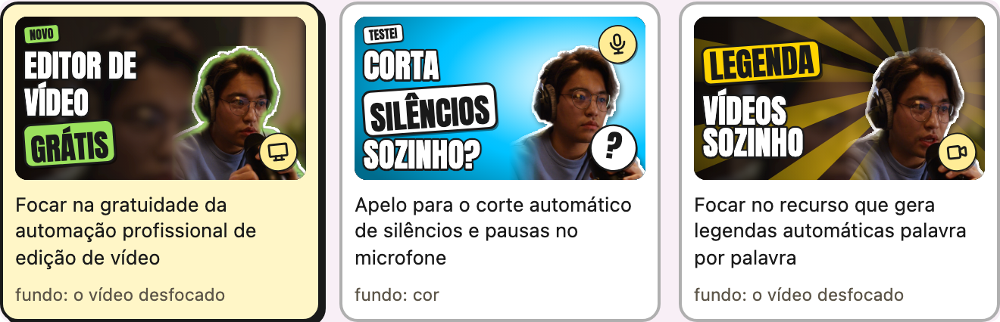
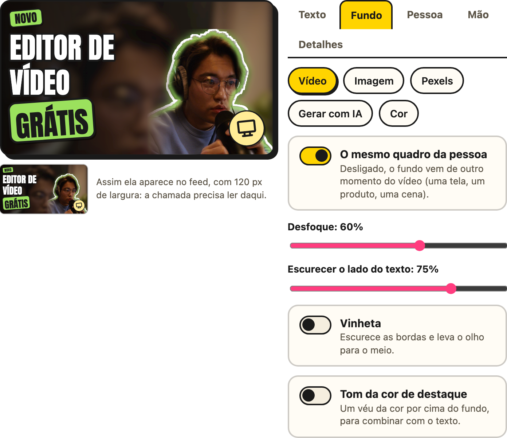

# A thumbnail

O passo 5 monta uma capa à parte, em camadas. Cada camada tem uma aba, e a prévia muda
enquanto você mexe. Embaixo da prévia, um botão **Baixar** para cada formato entrega a
capa como está na tela, em JPG (e em PNG), e guarda uma cópia na pasta do vídeo. Funciona
antes e depois de editar o vídeo.

  

- **Texto:** a chamada, de 2 a 5 palavras, a palavra que vai no adesivo e o modelo:
  clássico, número, pergunta ou alerta.
- **Fundo:** o que vai atrás da pessoa, de uma das cinco fontes da tabela abaixo, com
  desfoque, escurecer, vinheta e um tom da cor de destaque.
- **Pessoa:** o recorte, o tamanho, o espelho, o contorno branco, a luz (na borda, halo
  ou raios) e um realce de contraste. Para mudar a pessoa de lugar, arraste na prévia.
- **Mão:** um emoji de mão que gira sozinho até o dedo apontar para o título. Ela vem em
  3D ou em vetor, nos seis tons de pele, e também se arrasta.
- **Detalhes:** a cor de destaque, o ícone e o selo.

  

| Fonte do fundo | O que precisa | O que sai do computador |
|---|---|---|
| **Vídeo** | nada | nada. Pode ser outro quadro, que mostra o assunto |
| **Imagem** | um JPG, PNG ou WebP seu, de até 20 MB | nada |
| **Pexels** | uma [chave grátis do Pexels](https://www.pexels.com/api/), colada em **Antes de começar** | o texto da busca. As fotos vêm com o crédito do fotógrafo |
| **Gerada pelo Gemini** | uma chave do Gemini com faturamento ativo, uns US$ 0,04 por imagem | a descrição da cena, só quando você clica, e no máximo 10 imagens por sessão |
| **Cor** | nada | nada |

O recorte da pessoa usa o [MODNet](https://github.com/ZHKKKe/MODNet) no seu computador.
Na primeira thumbnail com recorte, o editor baixa o modelo, que tem 26 MB.

## Uma capa para cada plataforma

O formato da capa vem de **Onde você vai postar?**, no passo 1. Dá para marcar várias, e
sai uma capa por formato: uma em pé serve para Shorts, TikTok e Reels ao mesmo tempo.

| Plataforma | Capa | Onde ela é cortada |
|---|---|---|
| **YouTube** | 1280×720 | aparece inteira |
| **YouTube Shorts** | 1080×1920 | a busca mostra só o meio, em 3:2 |
| **TikTok** | 1080×1920 | o perfil mostra o meio, em 3:4 |
| **Instagram Reels** | 1080×1920 | o perfil mostra o meio, em 3:4, e o feed, em 4:5 |

- **A recomendação:** um vídeo em pé (ou quadrado) recomenda Shorts, TikTok e Reels; um
  deitado, o YouTube. Até você mexer, a escolha segue a recomendação.
- **A capa em pé:** a chamada e o rosto ficam dentro do pedaço que os perfis do TikTok e
  do Instagram mostram. Com Shorts marcado, a chamada também cabe no meio que a busca do
  YouTube mostra. A prévia desenha esses cortes com linhas tracejadas, que não saem na
  imagem, e a miniatura mostra a capa como o perfil mostra.
- **O Shorts:** a capa própria de um Short só vale para quem está no Programa de
  Parcerias do YouTube, e só pelo computador (desde julho de 2026).
- **Na montagem,** a plataforma também decide o quadro do vídeo: em pé para Shorts,
  TikTok e Reels, e deitado para o YouTube. Com as duas misturadas, vale o que estiver
  no passo 4.
- **As ideias do Gemini** sabem onde o vídeo vai ser postado.

## Ideias do Gemini (opcional)

Com uma chave do Gemini, a IA lê o que você falou, olha 8 quadros do vídeo e sugere 3
thumbnails. Cada ideia escolhe a chamada, o modelo, o quadro, o fundo, a luz, a mão e o
ícone, e tudo continua editável.

1. Pegue uma chave grátis no [Google AI Studio](https://aistudio.google.com/apikey).
2. Cole em **Antes de começar**, logo abaixo do título, no cartão **Chave do Gemini**: a
   mesma chave serve às ideias de
   thumbnail, à matriz das cenas e aos cartões. Ela fica só no seu computador, num
   arquivo que só o seu usuário lê, e nunca volta para a página. A variável `GEMINI_API_KEY` também funciona.
3. Ligue **Sugerir thumbnails com IA**. As ideias aparecem quando a edição termina.

> [!IMPORTANT]
> Vão para o Google o texto da fala e 8 quadros pequenos, de 512 px. O vídeo não sai do
> computador. Na cota gratuita, o Google pode usar esse conteúdo para melhorar os
> produtos dele.

A cota gratuita é pequena. Em outubro de 2026, o modelo principal aceitava 20 pedidos
por dia, e cada sugestão gasta um ou dois. Quando a cota de um modelo acaba, o editor
passa para o próximo, e o aviso diz quando ela volta.
