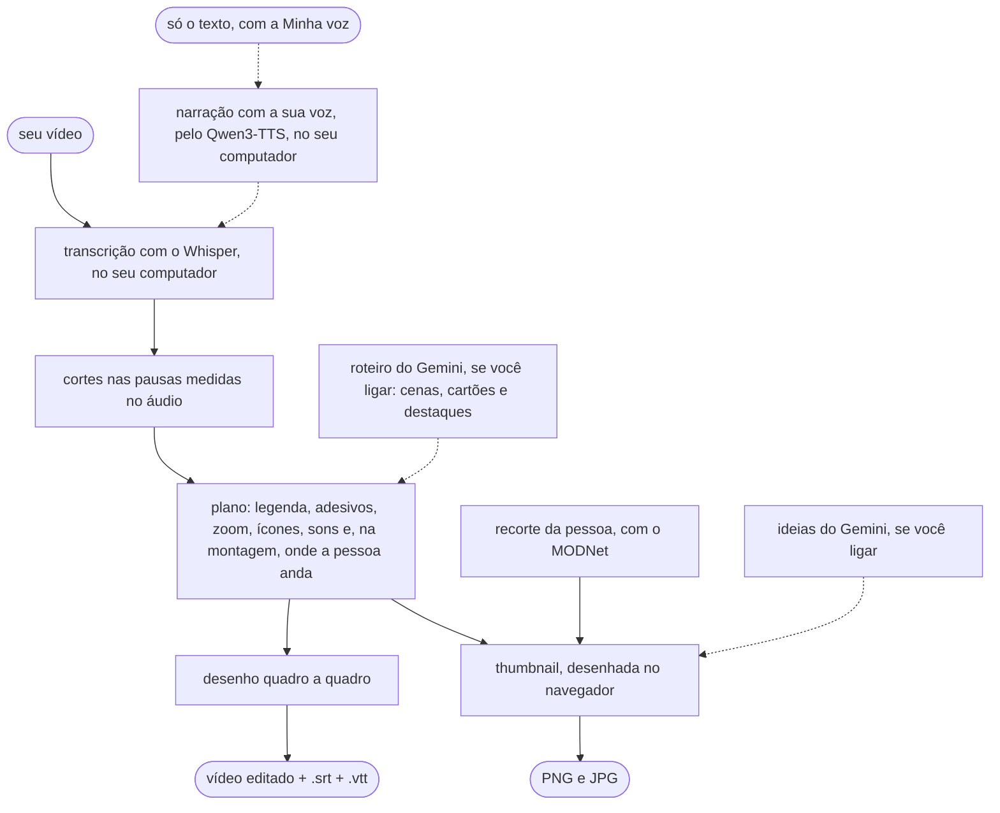

# Como funciona

1. O **PyAV** lê o vídeo e o áudio. Ele traz o FFmpeg dentro dele, por isso nada precisa
   ser instalado no sistema.
2. O **Whisper** (com o [faster-whisper](https://github.com/SYSTRAN/faster-whisper)) diz
   cada palavra e quando ela foi dita. O resultado fica guardado, então editar de novo
   com outras opções não transcreve outra vez.
3. Os **cortes** procuram a pausa real no áudio em volta de cada palavra. O Whisper
   costuma marcar o fim da palavra cedo e o começo da seguinte muito cedo, e o corte no
   tempo dele comeria sílabas ou deixaria meia pausa.
4. O **plano** decide, por regras, cada linha de legenda, cada adesivo, zoom, ícone e
   som e, na montagem, onde a pessoa anda. Com o roteiro ligado, as cenas, os cartões e
   os destaques da legenda vêm do Gemini, conferidos pelo editor. Ele vai junto do vídeo,
   como `.plano.json`.
5. Cada quadro é **desenhado** em Python e gravado no formato escolhido. O áudio recebe
   uma transição de 8 ms em cada corte, para não estalar. Na montagem, o fundo e quem
   vai por cima começam juntos, e os cortes valem para os dois.
6. A **thumbnail** é desenhada na página. A prévia ao vivo usa o
   [Remotion Player](https://www.remotion.dev/player), e o PNG final sai do mesmo desenho,
   no próprio navegador. A pessoa é recortada pelo MODNet, com o ONNX Runtime, e as ideias
   opcionais vêm da API do Gemini.
