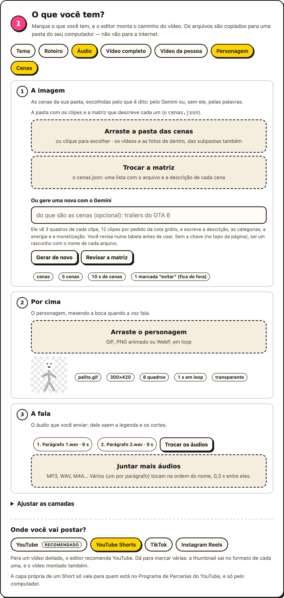

# Como usar

O passo 1 começa pelo que você tem. Marque as pílulas, e o editor monta **a trilha**, o
caminho do vídeo. Cada etapa pede só o que falta, e o tour da página (botão **Tour**, no
topo) mostra como.

| O que você marca | O que vira |
|---|---|
| **Vídeo completo** | O fundo, com ou sem alguém falando nele. Sozinho, é o vídeo que sai editado, o jeito mais simples |
| **Vídeo da pessoa** | Você, recortado por cima do fundo |
| **Personagem** | Um GIF que mexe a boca quando a voz fala, por cima do fundo |
| **Cenas** | Uma pasta de vídeos e fotos, escolhidos pelo que é dito. Com o vídeo completo, as cenas viram o fundo, e o vídeo vai por cima, recortado |
| **Áudio** | A fala gravada à parte: dela saem a legenda e os cortes |
| **Roteiro** | Com um vídeo falando, corrige a grafia da legenda. Sem ele, a sua voz narra o roteiro ([Minha voz](./minha-voz)) |
| **Tema** | O assunto, em uma frase. Sozinho, a IA escreve o roteiro, o Editai acha as fotos e uma voz narra ([O vídeo só pelo tema](./o-video-so-pelo-tema)). Com um vídeo, vai de contexto para o Gemini, nos cartões e na escolha das cenas |

**De onde vem a fala**, que dá a legenda e os cortes: do áudio; senão, do vídeo de quem
fala; senão, do roteiro narrado. **Quem vai por cima**, quando ninguém fala na tela: o seu
avatar, se você tiver um, ou ninguém. Na montagem, **Ajustar as camadas** troca as duas
coisas à mão. **Sem vídeo e sem cenas**, a imagem são fotos achadas pelo que é dito, e só
com o tema a IA escreve o roteiro: veja [O vídeo só pelo tema](./o-video-so-pelo-tema).

Logo abaixo do título, **Antes de começar** junta o que se configura uma vez e vale para
todos os vídeos, tudo opcional: a sua voz gravada ([Minha voz](./minha-voz)), o seu avatar em
pixel art ([Meu avatar](./meu-avatar)) e as chaves grátis do Gemini e do Pexels. Cada cartão diz se já está pronto e abre o próprio painel.

## Quanto tempo

No fim do passo 1, logo abaixo de **Onde você vai postar?**, você escolhe quanto o vídeo deve
durar. Vale para todo vídeo: o seu, a montagem e o feito pelo tema.

| A escolha | O que acontece |
|---|---|
| **Auto** (o padrão) | O vídeo fica com o que você gravou. Só se ele passar do limite da plataforma marcada (3 min no Shorts e no Reels, 10 min no TikTok), a IA escolhe as frases que ficam. No YouTube, nada sai |
| **15 s, 20 s… 10 min** | O vídeo fica com uns tantos segundos, de 15% a menos a 15% a mais (o corte cai sempre entre frases). Se a fala passar disso, a IA escolhe as frases que ficam e o editor corta o resto |
| **Tudo** | Nada da fala sai: só os silêncios, como sempre |

**Como a IA escolhe:**
- as frases ficam inteiras e na ordem;
- o vídeo pode começar mais adiante, para abrir com uma frase que prende;
- nenhuma ideia fica pela metade: uma frase que retoma a anterior ("por isso", "ou seja",
  "esses…") só fica com ela;
- o fim fecha a ideia.

A legenda, o zoom, as cenas, os cartões e quem vai por cima seguem o corte. Sem a IA, o corte
é no fim, na última frase que cabe.

**No resultado,** a página diz quantas frases saíram e mostra cada uma em **O que ficou de
fora**. Se uma frase importante saiu, **Refazer com tudo** edita de novo sem tirar nenhuma.

**Um tempo maior que o limite** de uma plataforma marcada vira aviso. No vídeo pelo tema, a
escolha também é o tamanho do roteiro.

## Um vídeo seu falando

1. Digite `editai`. O navegador abre no editor.
2. No passo 1, **Vídeo completo** já vem marcado: arraste o vídeo e marque onde vai postar.
3. No passo 2, escolha o preset do tipo de vídeo: vlog, gameplay, review, aula,
   imóveis… ou um seu.
4. Se a fala tem nomes que o Whisper não conhece (o do seu projeto, marcas, termos em
   inglês), cole no passo 3, em **O que você falou**, o texto que você leu: a legenda
   pega a grafia dele ([veja como](./o-que-voce-falou)).
5. Clique em **Editar vídeo**. O vídeo editado, as legendas e as thumbnails ficam na
   pasta mostrada no resultado.

## Uma notícia montada com cenas

Para uma narração sobre um assunto com muitas imagens: um trailer, uma notícia, um jogo.
Você traz:

| O quê | Como |
|---|---|
| **A pasta das cenas** | clipes curtos, de uns 2 s cada; as subpastas também valem |
| **A matriz** | o `cenas.json`, dentro da pasta, com o arquivo e a descrição de cada cena (o formato está em [Biblioteca de cenas](./a-montagem-em-camadas#biblioteca-de-cenas)). Não tem? O botão **Gerar a matriz** escreve para você ([Gerar a matriz](./a-montagem-em-camadas#gerar-a-matriz)) |
| **A narração** | um arquivo de áudio, ou vários, um por parágrafo, que tocam na ordem do nome. Ou só o roteiro, narrado com a sua voz ([Minha voz](./minha-voz)) |
| **O personagem** (opcional) | um GIF, PNG animado ou WebP, com a boca fechada no primeiro quadro |
| **A chave do Gemini** (opcional e grátis) | colada em **Antes de começar**, no topo da página. Sem ela, as cenas saem pelas palavras e não há cartões |

1. No passo 1, marque **Cenas** e o que você tem para a fala: **Áudio** ou **Roteiro**
   (narrado pela sua voz, que se grava antes, uma vez, em **Antes de começar**). Para um
   personagem por cima, marque **Personagem** também.
2. Arraste a pasta: os clipes sobem, e o `cenas.json` de dentro dela entra junto. Sem ele,
   clique em **Gerar a matriz** e revise a tabela. A ficha mostra quantas cenas entraram e
   quantas ficaram de fora. Depois, envie o personagem e os arquivos da narração (ou narre
   o roteiro), cada um na sua etapa.
3. Em **Onde você vai postar**, marque Shorts, TikTok ou Reels para o vídeo sair em pé.
4. No passo 2, escolha o preset **Notícia com cenas**. Ele liga a janela com câmera, os
   cartões animados, a voz de estúdio, a legenda em destaques e os sons do tema Notícia.
   Se o assunto pede, escreva no **Bipe nas palavras** as que devem ser escondidas.
5. Se ainda não colou a chave do Gemini, cole em **Antes de começar**.
6. Clique em **Editar vídeo**. Uma narração de 50 s leva uns 2 minutos num MacBook M5. O
   resultado diz quantas cenas e cartões o Gemini escreveu e quantos pedidos da cota
   usou.

 

Algumas dicas:

- **Confira a legenda.** O Whisper `small` erra nomes: "leve no" já virou "Levin". O
  `medium`, no passo 3, erra menos e demora mais. Um erro na fala aparece na legenda e
  pode até virar a pílula de destaque. Se a narração não é da Minha voz, cole o texto em
  [O que você falou](./o-que-voce-falou).
- **O bipe** pega só as palavras da lista do passo 2, e a lista também ajuda o Whisper a
  ouvir essas palavras.
- **Na primeira vez sem internet,** os quatro sons do tema Notícia que vêm do Remotion
  tocam um parecido da Kenney.
- **No terminal,** o mesmo vídeo sai com
  `editai --cenas cenas/ --matriz cenas/cenas.json --audio p1.m4a p2.m4a --personagem boneco.gif --preset noticia --quadro vertical`.
