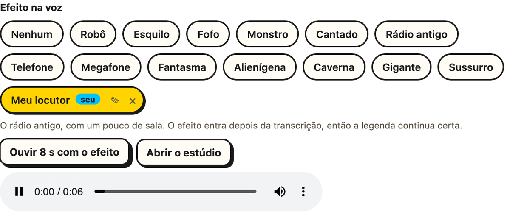
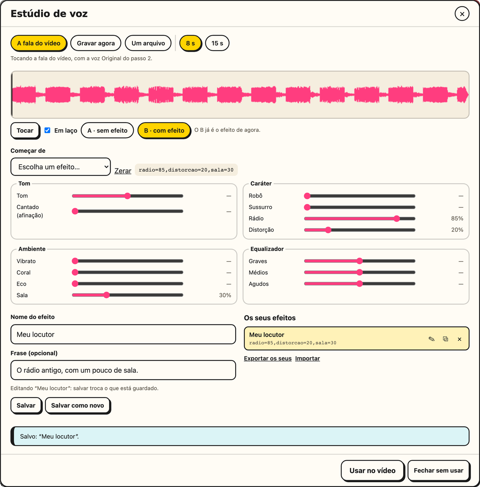

# Efeitos na voz

No passo 2, logo abaixo da voz, o **Efeito na voz** muda o som de quem fala. Vale para
qualquer voz: a do vídeo, a do áudio separado e a [Minha voz](./minha-voz). Escolha um
pronto, ouça 8 s com ele, ou monte o seu no [estúdio](#o-estudio-de-voz). Nada precisa
ser instalado: os filtros são os do FFmpeg que vem no PyAV, e o resto (o cantado, o
robô, o sussurro e a sala) é feito pelo próprio editor.

  

**Os prontos:**

| Efeito | Como soa | Os ajustes |
|---|---|---|
| **Robô** | metálico e sem entonação, com o zumbido de um robô | `tom=-2,robo=85,medios=3` |
| **Esquilo** | a voz de desenho animado, bem mais aguda e fina | `tom=9,agudos=2` |
| **Fofo** | mais aguda e suave | `tom=4,agudos=3` |
| **Monstro** | grave, rouca e com eco de caverna | `tom=-8,distorcao=25,sala=35,graves=6` |
| **Cantado** | afinada nota a nota, como um autotune | `afinacao=100` |
| **Rádio antigo** | a faixa estreita e o chiado de um rádio velho | `radio=85,distorcao=20` |
| **Telefone** | como numa ligação | `radio=65,medios=4` |
| **Megafone** | estourada e anasalada, de alto-falante | `radio=60,distorcao=60,medios=5` |
| **Fantasma** | sussurrada, trêmula e com eco | `sussurro=60,vibrato=40,eco=45,sala=55` |
| **Alienígena** | metálica, trêmula e um pouco mais aguda | `tom=3,robo=40,vibrato=55` |
| **Caverna** | eco longo, como num lugar grande e vazio | `eco=55,sala=75` |
| **Gigante** | grave e encorpada, com um pouco de sala | `tom=-5,graves=6,sala=30` |
| **Sussurro** | só o ar, sem a voz | `sussurro=100` |

**Os controles**, no estúdio, ficam em quatro grupos:

| Grupo | Controle | Faixa | O que faz |
|---|---|---|---|
| Tom | **Tom** | −12 a +12 semitons | sobe ou desce a voz sem mudar a duração; o timbre acompanha, como num desenho animado |
| Tom | **Cantado** | 0 a 100% | puxa cada trecho da fala para a nota mais perto, como um autotune; o timbre fica |
| Caráter | **Robô** | 0 a 100% | troca a entonação por um zumbido fixo de 120 Hz |
| Caráter | **Sussurro** | 0 a 100% | troca a voz por ar com o formato das vogais, sem os graves |
| Caráter | **Rádio** | 0 a 100% | estreita a faixa, de 100–8.000 Hz até 500–2.800 Hz |
| Caráter | **Distorção** | 0 a 100% | satura, como um alto-falante estourado |
| Ambiente | **Vibrato** | 0 a 100% | faz a voz tremer 5,5 vezes por segundo |
| Ambiente | **Coral** | 0 a 100% | junta cópias atrasadas da voz, diferentes em cada lado |
| Ambiente | **Eco** | 0 a 100% | duas repetições, a uns 250 e 500 ms |
| Ambiente | **Sala** | 0 a 100% | a reverberação, de uma sala pequena (0,3 s) até um salão (2,5 s) |
| Equalizador | **Graves**, **Médios** e **Agudos** | −12 a +12 dB | em 150 Hz, 1 kHz e 4 kHz |

- **Ouvir antes:** **Ouvir 8 s** passa os primeiros 8 s com fala pelo mesmo caminho da
  edição, com o tratamento escolhido (original, limpa ou estúdio), e toca na página. A
  fala é a que a edição vai usar: a do vídeo, a do áudio separado ou a narração.
- **Os seus** ficam só no seu computador, no `efeitos-de-voz.json` da pasta de dados. No
  passo 2, o ✎ abre um no estúdio e o × apaga. Um preset de edição seu também guarda o
  efeito.
- **A duração não muda.** Cada efeito devolve o mesmo número de amostras, então os
  cortes, a legenda e o bipe ficam no lugar.
- **A legenda não sofre.** O efeito entra depois da transcrição: o Whisper ouve a voz
  sem efeito.
- **O bipe vem antes do eco e da sala**, para a sílaba proibida não voltar na cauda.
- **O volume fica o mesmo** em que a voz entrou.

**Medido** numa gravação de verdade, com a voz em 145 Hz: o esquilo levou a 242 Hz (+9
semitons dá 244), o fofo a 182 Hz (183) e o monstro a 92 Hz (91). No cantado, os trechos
a menos de 25 cents de uma nota passaram de 50% para 92%. No M5, um minuto de voz leva
menos de 1 s no cantado e menos ainda nos outros.

## O estúdio de voz

**Abrir o estúdio** (passo 2) abre uma tela só para montar um efeito de ouvido:

  

1. **A amostra:** a fala do vídeo (a que a edição vai usar), uma gravação feita ali,
   pelo microfone, ou um arquivo; 8 ou 15 s. A gravação e o arquivo ficam no computador.
2. **Ouça e compare:** **Tocar**, **Em laço** e **A · sem efeito** / **B · com efeito**.
   Trocar entre os dois continua do mesmo ponto, e um clique na forma de onda pula para
   lá. Os dois saem do mesmo caminho da edição, com o tratamento da voz do passo 2.
3. **Ajuste:** comece de um pronto ou de um seu, ou do zero, e mexa nos controles. Uns
   400 ms depois de cada mudança, o B já é o efeito novo, sem parar de tocar.
4. **Guarde:** um nome e uma frase, e **Salvar**. Na lista dos seus, o ✎ abre um para
   editar (salvar com outro nome renomeia), o ⧉ duplica e o × apaga. **Exportar os seus**
   baixa o `meus-efeitos-de-voz.json`, e **Importar** junta os de outro computador (o
   mesmo nome substitui).
5. **Usar no vídeo** leva o efeito para o passo 2. **Fechar sem usar** (ou o Esc) não
   muda nada.

> [!NOTE]
> Um efeito muda o som, não a emoção: "feliz" ou "triste" dependem de como a frase é
> dita. Na Minha voz, o motor imita o jeito de falar da sua leitura, e o modelo dele (o
> Qwen3-TTS que clona a voz) não aceita um pedido como "fale triste".
