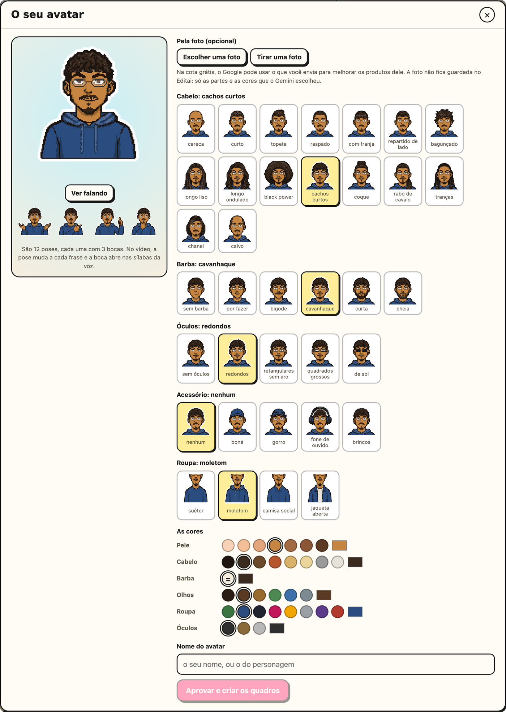

# Meu avatar

Opcional. Um personagem seu em pixel art, que fala no seu lugar na montagem e aparece na
thumbnail. Ele é feito uma vez e não custa nada:
não há IA de imagem desenhando quadro a quadro. É a lógica dos jogos de montar personagem:
um cabelo, uma barba, uns óculos, uma roupa e as cores de cada coisa.

  

1. **Abra o cartão.** Em **Antes de começar**, no cartão **Avatar**, clique em
   **Configurar**.
2. **Pela foto (opcional).** Escolha uma foto sua, ou tire uma pela câmera, e clique em
   **Montar pela foto com o Gemini (grátis)**. O Gemini olha a foto e escolhe uma opção de
   cada categoria e as cores, só entre as do catálogo. A foto não fica guardada; na cota
   grátis, o Google pode usar o que recebe para melhorar os produtos dele.
3. **Ajuste à mão.** Cada opção aparece desenhada no seu avatar, com as suas cores: são 16
   cabelos, 6 barbas, 5 óculos, 5 acessórios, 4 roupas e as cores da pele, do cabelo, da
   barba, dos olhos e da roupa. A prévia mostra o avatar falando. Sem a chave do Gemini, é
   assim que se monta.
   - **Ou um bicho:** em **Cabeça**, no lugar da pessoa, 20 bichos (cachorro, gato, raposa,
     panda, coelho, ovelha, pato, girafa, elefante, urso, leão, lobo, pinguim, porco, vaca,
     galinha, sapo, cavalo, lontra e guaxinim), com os olhos e a boca que falam. A
     **Pelagem** pinta o bicho, o pescoço e as mãos; a roupa continua a sua escolha.
4. **Aprove.** Dê um nome e clique em **Aprovar e criar os quadros**. A página desenha os
   36 quadros do avatar (12 poses, cada uma com 3 bocas) e guarda tudo no seu computador.
   Para mudar alguma coisa depois, **Ajustar** reabre o avatar no criador.

**Onde ele entra:**

- **No vídeo:** na etapa **Por cima** do passo 1, escolha **Meu avatar**. Quando a fala é
  um áudio ou um roteiro narrado, ele já vem escolhido.
  - **A pose muda a cada frase da legenda**, pela própria fala: numa pergunta, ele pensa; em
    "você", aponta para quem assiste; em "eu", põe a mão no peito; num número, levanta o
    dedo; em "olha aqui", aponta para o lado. Numa frase comprida, a pose também troca na
    vírgula.
  - **A boca abre nas sílabas** da voz: um quadro antes de cada sílaba, sempre pela meia boca.
    A sílaba fraca abre só até a meia. Num vídeo real, a boca ficou 52% do tempo fechada,
    29% meia e 19% aberta.
  - **Do lado direito da tela, ele vira** para apontar para o meio. Ao trocar de pose, dá um
    pulinho, e o pixel art é ampliado sem borrar.
- **Na thumbnail:** ele fica no lugar da pessoa. Na aba **Pessoa**, escolha a pose (a
  padrão é apontando para o lado). Ele vira sozinho para o lado do texto.
- **No pacote:** **Baixar o pacote** entrega os 36 PNG (900 × 900, fundo transparente), o
  padrão e um LEIA-ME com quando usar cada pose. Servem em qualquer outro editor.

**De onde vêm as partes:** do repositório
[editai-personagens](https://github.com/lucasteles1231/editai-personagens), em domínio
público (CC0). O Editai leva uma cópia dele, de uns 900 KB, e a página pede só as partes que
desenha. Cada parte nasceu de uma edição de um manequim no Nano Banana 2, foi vetorizada e
teve os tons separados por espaço de cor: por isso dá para pintar qualquer pele, cabelo, olho
ou roupa. As bocas e os óculos são desenhados em código. Com um boné ou um gorro, o cabelo que
passaria por cima fica escondido, e o que sai pelos lados fica amassado por ele. O padrão das poses, das bocas e da fala está em
[`editor/recursos/personagem/padrao.json`](https://github.com/lucasteles1231/editai/blob/main/editor/recursos/personagem/padrao.json).

No terminal: `editai --fundo tela.mp4 --audio narracao.m4a --avatar "Seu Nome"`.
