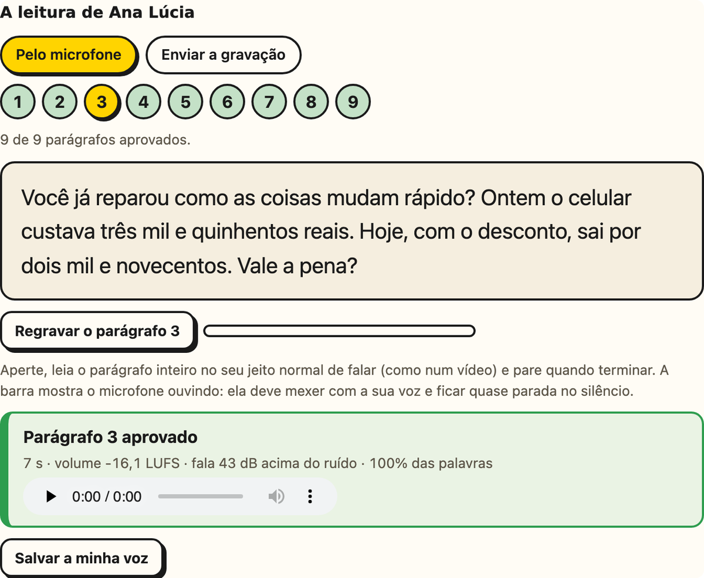
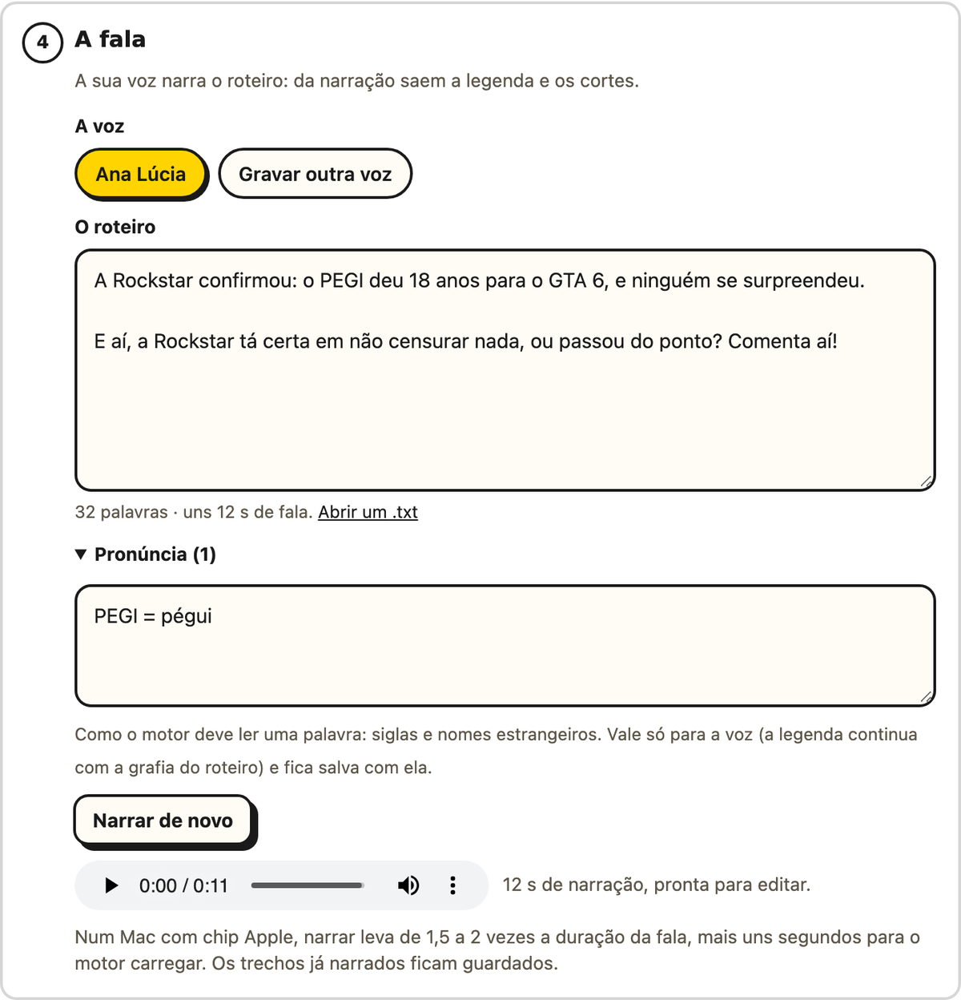

# Minha voz

Opcional. Você grava a sua voz uma vez, lendo um texto, e o editor narra qualquer
roteiro com ela: depois disso, você traz só o texto e as cenas. O motor é o
[Qwen3-TTS](https://github.com/QwenLM/Qwen3-TTS) 0.6B, de código aberto (Apache 2.0), e
roda no seu computador.

1. **Instale a voz.** Em **Antes de começar**, no cartão **Minha voz**, clique em
   **Configurar** e em **Instalar a voz sintetizada**. Ela fica num ambiente à parte, com
   uns 3,5 GB, e leva de 5 a 20 minutos, uma vez só. Desinstalar, pelo link do mesmo
   painel, apaga a pasta inteira. No painel ficam também as vozes gravadas, para ouvir e
   apagar.
2. **Grave a leitura.** Diga o seu nome e leia o texto: 9 parágrafos curtos, uns 2
   minutos. O primeiro é a autorização, com o seu nome. Pelo microfone, a página mostra
   um parágrafo de cada vez, em letra grande. Ou grave o texto inteiro no celular e envie
   o arquivo.
3. **A conferência.** Cada parágrafo é transcrito pelo Whisper e comparado ao texto,
   palavra por palavra. O que não passar volta com o motivo, e dá para regravar só ele.
4. **Narre o roteiro.** No passo 1, marque **Roteiro** e a imagem (as cenas ou um vídeo de
   fundo sem fala): a etapa da fala já vem com a sua voz. Com um vídeo que tem fala,
   **Narrar o roteiro** troca o som dele pela narração. Cole o texto (ou abra um `.txt`) e
   clique em **Narrar o roteiro**. A narração vira o áudio da montagem, e o resto é o de sempre: a legenda,
   os cortes, as cenas, os cartões e o bipe.

 

**O que a conferência pede**, em cada parágrafo:

| O quê | O limite | Por quê |
|---|---|---|
| a leitura | 90% das palavras, na ordem | os números contam por extenso dos dois lados: "3.500" ouvido vale o "três mil e quinhentos" lido. O texto não vai de dica para o Whisper: com ele, o Whisper "ouviria" o texto mesmo com a leitura errada |
| a autorização | o "autorizo", com o seu nome | só existe este caminho para criar uma voz, que é ler o texto. Não há "clonar de um áudio qualquer" |
| o volume | acima de −45 LUFS | gravações de celular ficaram entre −31 e −36 LUFS e deram um clone bom; abaixo de −45, o microfone está longe demais |
| o som estourado | menos de 0,1% das amostras no teto | o modelo copiaria a distorção |
| o ruído | a fala pelo menos 18 dB acima do silêncio | as gravações de teste ficaram entre 26 e 30 dB |

**Por que 2 minutos de leitura, se a voz usa uns 25 s.** O modelo não aprende com a
gravação: ele a usa de exemplo a cada frase. No teste, o juiz foi o ECAPA, um modelo que
reconhece quem fala. Num texto novo, a semelhança do clone com a voz real subiu de 0,70
para 0,75 quando o exemplo passou de 8 para 26 s, e não subiu mais com 38 s, que só
deixaram a geração 6% mais lenta. Para comparar, duas gravações reais da mesma pessoa, do
mesmo tamanho, deram de 0,73 a 0,74, e a voz de outra pessoa, 0,02. A leitura mais longa
serve para escolher os trechos mais limpos, com uma pergunta entre eles, e para passar
por todos os sons do português.

**A narração:**

- **Em pedaços:** o roteiro vai ao motor em frases inteiras, de até ~220 letras. Os
  parágrafos ficam separados por 0,6 s, e as frases, por 0,3 s, e o volume sai no dos
  Shorts (−15 LUFS).
- **Guardada:** cada pedaço fica guardado. Mudar uma frase do roteiro narra só ela de
  novo.
- **A pronúncia:** uma lista como `PEGI = pégui` muda só o que o motor lê. A legenda volta
  para a grafia do roteiro: no teste, o Whisper ouviu "o Pegue deu 18 anos para o GTA
  VI", e a legenda saiu como estava escrito, "o PEGI deu dezoito anos para o GTA 6".
- **O tempo**, num MacBook M5: na placa do Mac, de 1,4 a 1,8 vez a duração da fala, mais
  uns 7 s para o motor carregar. Só no processador, umas 3,4 vezes, com até 7,5 GB de
  memória. Num PC sem placa NVIDIA, conte com mais.

 

> [!WARNING]
> Use só a sua própria voz. Clonar a voz de outra pessoa sem a permissão dela é ilegal. A
> autorização gravada no começo da leitura fica guardada junto da voz.

Tudo fica no computador: a gravação, a voz salva (na pasta `vozes`, ao lado do
`config.json`) e o modelo. Nenhum áudio vai para a internet. No terminal, a voz é criada
com `editai --criar-voz "Seu Nome" --gravacao leitura.m4a` e usada com `--minha-voz`
(veja [No terminal](./no-terminal)).
