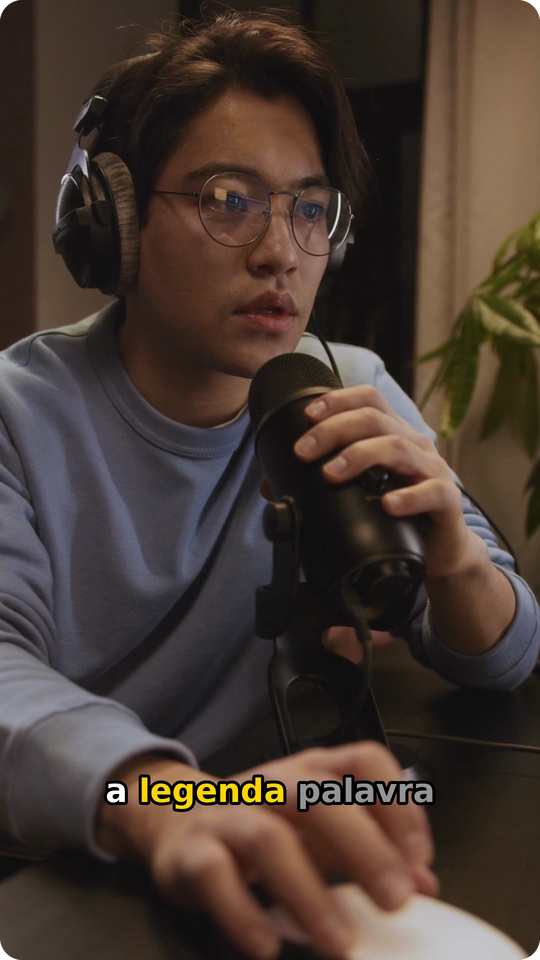
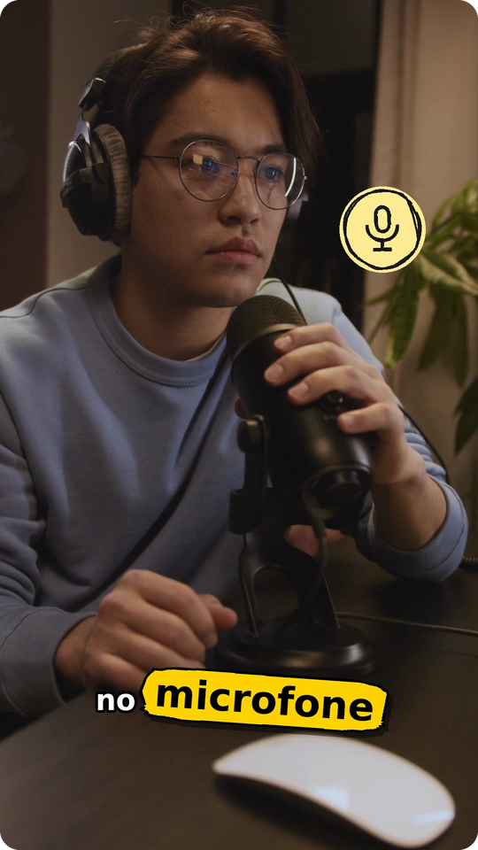
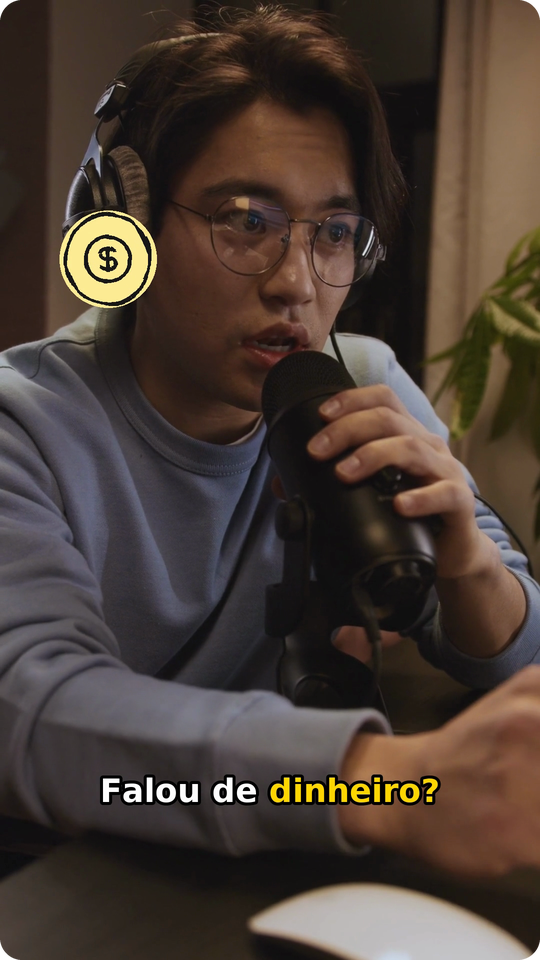
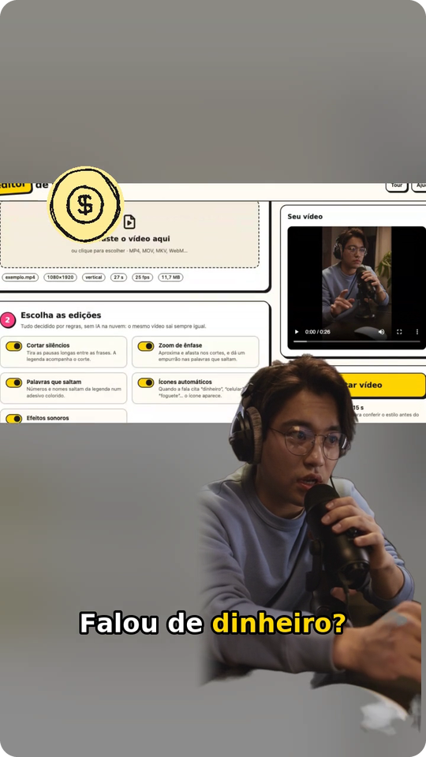
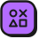

# O que ele faz

<table>
  <tr>
    <td align="center" width="25%"></td>
    <td align="center" width="25%"></td>
    <td align="center" width="25%"></td>
    <td align="center" width="25%"></td>
  </tr>
  <tr>
    <td align="center"><b>Legenda karaokê</b> a palavra acende quando é dita; a palavra-chave fica amarela</td>
    <td align="center"><b>Adesivos</b> números, nomes e palavras fortes saltam da legenda</td>
    <td align="center"><b>Ícones automáticos</b> falou "dinheiro", "celular" ou "foguete"? O ícone aparece</td>
    <td align="center"><b>Fundo e pessoa em camadas</b> a tela gravada atrás, e você (ou um personagem) andando por cima</td>
  </tr>
</table>

<table>
  <tr>
    <td width="56"></td>
    <td><b>Corta os silêncios.</b> Toda pausa maior que 0,45 s vira um respiro de 0,15 s, e
    o começo e o fim do vídeo são aparados. O corte é medido no áudio, e não no tempo que o
    Whisper dá, então não come o fim da sílaba nem deixa meia pausa para trás.</td>
  </tr>
  <tr>
    <td></td>
    <td><b>Legenda karaokê.</b> Uma linha por vez, curta (até 18 caracteres no vídeo vertical),
    quebrada na pontuação e nas pausas, com contorno preto que lê bem em qualquer fundo.
    Também sai em <code>.srt</code> e <code>.vtt</code>, com os tempos já cortados.</td>
  </tr>
  <tr>
    <td></td>
    <td><b>Adesivos.</b> A palavra mais forte do trecho salta para um balão ou uma estrela
    colorida, e as vizinhas abrem espaço. A prioridade é número, depois nome próprio, depois
    palavra longa. Em média, no máximo um a cada 12 s, para não cansar.</td>
  </tr>
  <tr>
    <td></td>
    <td><b>Zoom de ênfase.</b> O enquadramento alterna entre 100% e 112% nos cortes, o que
    esconde o "pulo" da edição, e dá um empurrão rápido em cada adesivo.</td>
  </tr>
  <tr>
    <td></td>
    <td><b>Fundo e pessoa em camadas.</b> Opcional. Um vídeo de fundo sem pessoa (a tela
    gravada, um jogo, slides) e, por cima, o vídeo de você falando ou um personagem animado
    em loop. Em alguns cortes, quem está por cima vai para um lado, para o meio, para cima,
    para baixo, para perto ou para longe. Com um ícone no trecho, vai para o lado oposto e
    deixa o lugar para ele. Veja <a href="./a-montagem-em-camadas">A montagem em
    camadas</a>.</td>
  </tr>
  <tr>
    <td></td>
    <td><b>Biblioteca de cenas.</b> Opcional, na montagem. No lugar do vídeo de fundo, uma
    pasta de clipes curtos e uma matriz que descreve cada um (o <code>cenas.json</code>),
    que o próprio editor gera se você não tiver. O Gemini escolhe, trecho a trecho, as
    cenas que mostram o que está sendo dito; sem ele, as palavras escolhem. A cena toca numa janela com câmera, e o personagem fica em
    pé na borda dela. Veja <a href="./a-montagem-em-camadas#biblioteca-de-cenas">Biblioteca de cenas</a>.</td>
  </tr>
  <tr>
    <td></td>
    <td><b>Cartões animados e legenda em destaques.</b> Opcional, com o Gemini. Selo,
    lista, quadro, enquete, carimbo, número e flash entram na palavra em que o assunto é
    dito, cada um com o seu som. A legenda pode vir em páginas de até 4 palavras, com os
    nomes em ciano, as expressões em rosa e a frase de efeito numa pílula amarela. Veja
    <a href="./cartoes-animados">Cartões animados</a>.</td>
  </tr>
  <tr>
    <td></td>
    <td><b>Voz, efeitos e bipe.</b> A voz pode sair limpa (sem eco, sem chiado e no mesmo
    volume em todas as partes) ou de estúdio, e ganhar um efeito: robô, esquilo, cantado,
    rádio, fantasma ou um seu. As palavras proibidas ganham um bipe numa sílaba e
    asteriscos na legenda: "porca**a". Veja <a href="./voz-e-bipe">Voz e bipe</a> e
    <a href="./efeitos-na-voz">Efeitos na voz</a>.</td>
  </tr>
  <tr>
    <td></td>
    <td><b>Minha voz.</b> Opcional, instalada à parte. Você lê um texto de 2 minutos uma
    vez, e a sua voz narra qualquer roteiro: depois disso, basta trazer o texto e as cenas.
    A legenda sai com a grafia do roteiro, e tudo roda no seu computador. Veja
    <a href="./minha-voz">Minha voz</a>.</td>
  </tr>
  <tr>
    <td></td>
    <td><b>Ícones automáticos.</b> 122 ícones (Tabler) com traço de caneta, que aparecem
    quando a palavra é dita, inclusive no plural e com sinônimo ("grana" vira dinheiro, "pix"
    vira celular).</td>
  </tr>
  <tr>
    <td></td>
    <td><b>Efeitos sonoros.</b> Sete temas, do pop de sempre ao de videogame, ao de humor e
    ao épico. A palavra também chama o som dela ("dinheiro" toca moedas, "errado" uma
    buzina) e, se quiser, cada corte ganha um clique. Tudo por baixo da sua voz. Veja
    <a href="./efeitos-sonoros">Efeitos sonoros</a>.</td>
  </tr>
  <tr>
    <td></td>
    <td><b>Presets.</b> Short de gameplay, de vlog e de review, explicação técnica, humor,
    motivacional, corte de podcast, aula, divulgação de imóveis e notícia com cenas. Um
    clique muda o ritmo, os sons, a legenda, a voz, a saída e a thumbnail, e tudo continua
    editável. O que você ajustar vira um preset seu, que fica só no seu computador e vai
    para outro num arquivo. Veja <a href="./presets">Presets</a>.</td>
  </tr>
  <tr>
    <td></td>
    <td><b>Thumbnail.</b> A pessoa é recortada do fundo, no seu computador, e vai na frente
    de outro quadro do vídeo, de uma imagem sua, de uma foto do Pexels ou de uma cor. Tem
    luz, contorno e uma mão apontando para o título, e o Gemini pode sugerir 3 ideias de
    acordo com o que você falou. Ela sai no formato de cada plataforma marcada no passo 1
    (YouTube, Shorts, TikTok e Reels), com a chamada e o rosto dentro do pedaço que o
    perfil mostra. O botão <b>Baixar</b> entrega em JPG de até 2 MB, que é o limite do
    YouTube, e em PNG.</td>
  </tr>
  <tr>
    <td></td>
    <td><b>100% local.</b> A interface é uma página servida pelo próprio editor, só para o seu
    computador. Depois do primeiro download do modelo, funciona até sem internet.</td>
  </tr>
</table>

A edição do vídeo segue regras fixas, e o mesmo vídeo sai sempre igual. As IAs que rodam
no seu computador são o Whisper, que transcreve a fala, e o MODNet, que recorta a pessoa
para a thumbnail e para a montagem em camadas. Se você instalar a Minha voz, entra também
o Qwen3-TTS, que narra com a sua voz.
O Gemini só entra se você colar uma chave: nas ideias de thumbnail e, quando ligado, no
roteiro (as cenas da biblioteca, os cartões animados e os destaques da legenda). O
roteiro é um pedido de texto da cota grátis por vídeo, mais um quando a resposta precisa
de conserto. O resultado diz quantos foram, contando as tentativas que o Google recusou.
