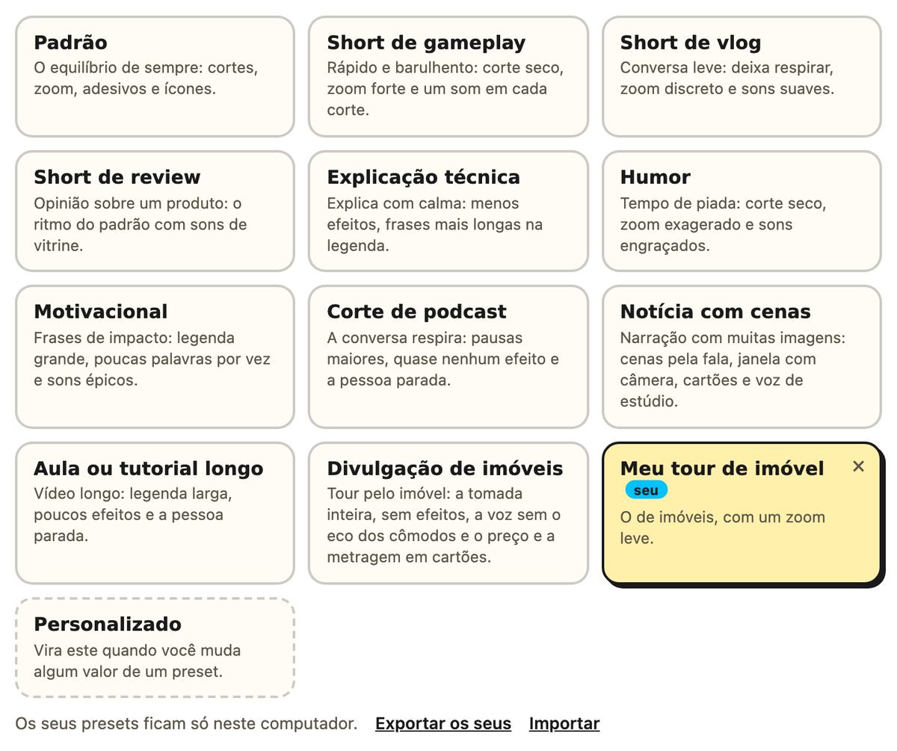

# Presets

O passo 2 começa pelos presets, um ponto de partida para cada tipo de vídeo. Escolher um
muda o ritmo e as edições, os sons, a legenda, a saída e a thumbnail. Cada valor continua
editável, e mexer em qualquer um troca a marca para **Personalizado**.

| Preset | Para quê | O que ele muda |
|---|---|---|
| **Padrão** | o equilíbrio de sempre | pausa de 0,45 s, zoom de 12%, o pop e o whoosh |
| **Short de gameplay** | jogo e ação | pausa de 0,30 s, ritmo 1,5×, sons de videogame com um clique em cada corte, legenda de 14 letras e 60 quadros por segundo |
| **Short de vlog** | conversa leve | pausa de 0,60 s, zoom de 8%, ritmo 0,8× e sons suaves |
| **Short de review** | opinião sobre um produto | o ritmo do padrão, sons de cliques e confirmações e thumbnail com número |
| **Explicação técnica** | explicar com calma | ritmo 0,7×, zoom de 6%, sons discretos e legenda de 20 letras |
| **Humor** | tempo de piada | pausa de 0,25 s, zoom de 18%, ritmo 1,6× e sons engraçados, também nos cortes |
| **Motivacional** | frases de impacto | legenda grande, de 14 letras, e sons épicos |
| **Corte de podcast** | conversa que respira | pausa de 0,80 s, respiro de 0,25 s, ritmo 0,6×, quase nenhum som e a pessoa parada |
| **Aula ou tutorial longo** | vídeo longo | ritmo 0,5×, legenda de 36 letras, poucos efeitos e a pessoa parada |
| **Divulgação de imóveis** | o tour por uma casa ou um apartamento | a tomada inteira, sem cortar as pausas (o tour quase não tem fala), sem zoom, adesivos, ícones nem sons, a voz limpa (sem o eco dos cômodos vazios), a legenda discreta e, com o Gemini, o preço e a metragem em cartões |
| **Notícia com cenas** | narração sobre um assunto com muitas imagens | janela e câmera, cartões animados, legenda em destaques, voz de estúdio, pausa de 0,35 s, ritmo 1,2× e os sons do tema Notícia |

- **O formato** (em pé ou deitado) não é do preset: vem da plataforma escolhida no passo
  1. O preset muda o estilo, e o modelo e a cor da thumbnail.
- **O ritmo** multiplica quantos adesivos, ícones, zooms e sons entram. Em 2×, entra o
  dobro, mais perto um do outro; em 0,5×, a metade.
- **O respiro** é o silêncio que fica no lugar de uma pausa cortada.
- **Nos outros presets,** menos no padrão, a voz sai limpa. Os de gameplay, review,
  explicação técnica, humor, motivacional, aula e imóveis também ligam os cartões animados. A
  janela fica ligada em todos, menos no de imóveis, mas só aparece na montagem.
- **No de imóveis,** a música do tour fica por sua conta: o editor não põe música. Se o
  vídeo já chega com ela, escolha a voz **Original** no passo 2, para a limpeza não mexer
  na música.
- **No terminal,** é `--preset gameplay`. Veja [No terminal](./no-terminal).

## Os seus presets

Gostou de um ajuste? Ele vira um preset seu, que aparece junto dos prontos, com a marca
**seu**.

1. Escolha um preset e mude o que quiser: a marca vai para **Personalizado**.
2. Clique em **Salvar como preset**, dê um nome e, se quiser, uma frase.
3. Pronto: o cartão novo fica no passo 2, inclusive depois de fechar e abrir o editor.

- **O que ele guarda:** o mesmo que os prontos, ou seja, as edições, a saída e o modelo e
  a cor da thumbnail.
- **Onde fica:** só no seu computador, no `presets.json` da pasta de dados do seu usuário
  (veja [O que é instalado, e onde](./instalacao-em-detalhe)). Outra conta do mesmo
  computador não vê.
- **Para mudar:** ajuste e salve com o mesmo nome. O editor pergunta antes de substituir.
- **Para apagar:** o **×** do cartão.
- **Para levar a outro computador:** **Exportar os seus** baixa o `meus-presets.json`, e
  **Importar**, no outro computador, junta esses presets aos de lá (o mesmo nome
  substitui).
- **As conferências:** cada valor passa pelas mesmas conferências da edição, inclusive o
  que vem de um arquivo importado. O nome de um preset pronto não pode ser usado, e
  cabem até 50.
- **No terminal:** `editai --preset gameplay --ritmo 1.3 --salvar-preset "Meu gameplay"`
  salva o preset de partida com as flags por cima. Depois é só usar `--preset
  meu-gameplay`, e o `--presets` lista os prontos e os seus.

 
