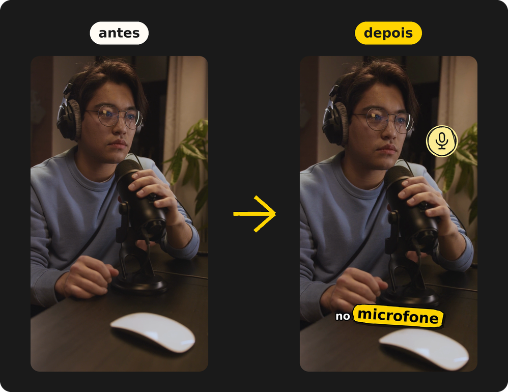

<Baixar compacto />

Você grava falando, com as pausas e os respiros de quem fala. O Editai faz a edição que
tomaria uma tarde: corta os silêncios, escreve a legenda palavra por palavra, faz as
palavras importantes saltarem da tela, põe zoom, ícones e efeitos sonoros, e ainda gera a
thumbnail. Para um vídeo de notícia, você nem aparece: traz uma pasta de cenas e a narração
(ou só o roteiro, lido pela sua voz), e ele monta o resto.

Por padrão, ele roda **inteiro no seu computador**, sem conta, sem chave de API, sem
assinatura e sem marca d'água.

  <a href="./guia/o-que-ele-faz"><b>Corta os silêncios</b>As pausas viram respiros curtos, medidos no áudio: não come o fim da sílaba.</a>
  <a href="./guia/o-que-ele-faz"><b>Legenda karaokê</b>Uma linha curta por vez, a palavra acende quando é dita. Também em .srt e .vtt.</a>
  <a href="./guia/o-que-ele-faz"><b>Adesivos</b>Números, nomes e palavras fortes saltam da legenda num balão colorido.</a>
  <a href="./guia/o-que-ele-faz"><b>Zoom de ênfase</b>O enquadramento alterna nos cortes e esconde o pulo da edição.</a>
  <a href="./guia/o-que-ele-faz"><b>Ícones automáticos</b>Falou "dinheiro", "celular" ou "foguete"? O ícone aparece.</a>
  <a href="./guia/efeitos-sonoros"><b>Efeitos sonoros</b>Sete temas, e a palavra chama o som dela: "dinheiro" toca moedas.</a>
  <a href="./guia/a-montagem-em-camadas"><b>Fundo e pessoa em camadas</b>A tela gravada atrás, e você, um personagem ou o seu avatar por cima.</a>
  <a href="./guia/a-montagem-em-camadas#biblioteca-de-cenas"><b>Biblioteca de cenas</b>Uma pasta de clipes, e as cenas que mostram o que está sendo dito.</a>
  <a href="./guia/cartoes-animados"><b>Cartões animados</b>Selo, lista, quadro, enquete e número entram na palavra certa.</a>
  <a href="./guia/voz-e-bipe"><b>Voz, efeitos e bipe</b>Voz limpa ou de estúdio, robô ou esquilo, e bipe nas palavras proibidas.</a>
  <a href="./guia/minha-voz"><b>Minha voz</b>Leia um texto uma vez, e a sua voz narra qualquer roteiro.</a>
  <a href="./guia/presets"><b>Presets</b>Gameplay, vlog, review, aula, notícia: um clique muda tudo, e tudo continua editável.</a>
  <a href="./guia/a-thumbnail"><b>Thumbnail</b>A pessoa recortada na frente de outro quadro, com luz, contorno e uma mão apontando.</a>
  <a href="./guia/seguranca-e-privacidade"><b>100% local</b>A página é servida pelo próprio editor, só para o seu computador.</a>

